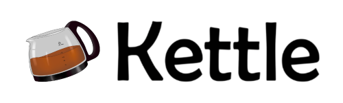

<p align="center"></p>
<h1 align="center">Kettle Programming Language</h1>


### Why did i make this language?
will i wanted to learn some stuff in python like dictionaries
***
### Syntax?
```
say -> print()
set -> variable
wait -> time.sleep()
operation -> print(int operation int)
random -> random.randint()
type of -> print(type(variable).__name__())
read -> input()
length of -> print(len())
```
***
### How to be able to use the language:
you could make a code editor for this language or integrate this in a vs-code extension (which i don't think any sane person would do for such a useless language) keep in mind that the command `read` needs a console capable of handling input so if you make a code editor for the language and have a text label console the `read` command may crash your app
***
### Notes
keep in mind that I'm not a professional programmer expect many bugs


